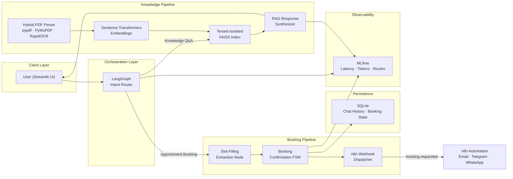

# GroqFlow

**Multi-Tenant AI Knowledge Assistant & Autonomous Appointment Booking Engine**

GroqFlow is a production-grade conversational AI platform that combines document-grounded knowledge retrieval with an autonomous appointment booking workflow. It serves multiple tenants from a single deployment, each with isolated knowledge bases, conversation histories, and booking configurations.



## Core Capabilities

| Capability | Implementation |
|---|---|
| **Multi-Tenant Isolation** | YAML-driven tenant configs with per-tenant FAISS indexes, document stores, and conversation histories |
| **Hybrid PDF Ingestion** | `pypdf` text extraction with automatic `RapidOCR` fallback for scanned pages (character-density heuristic) |
| **Stateful Agent Orchestration** | LangGraph directed graph with conditional routing between Knowledge Q&A and Booking flows |
| **Slot-Filling Booking** | Multi-turn detail extraction with Pydantic-validated field schemas per tenant |
| **Idempotent Event Webhooks** | `booking.requested` events dispatched to n8n with `X-Idempotency-Key` deduplication and Bearer auth |
| **Turn-Based Retry** | Failed webhook deliveries are retried on the next user message with the same `event_id` |
| **Selective File Filtering** | Users choose which uploaded PDFs are active for retrieval; hot-reindexing on duplicate uploads |
| **Conversation Persistence** | SQLite-backed per-user, per-tenant chat history with agent state serialization |
| **Observability** | MLflow experiment tracking for latency, intent routes, and booking conversion |

## Technology Stack

| Layer | Technology |
|---|---|
| Frontend | Streamlit (multi-tenant workspace UI) |
| Orchestration | LangGraph (stateful agent graph) |
| LLM Inference | Groq via LangChain (`openai/gpt-oss-20b`, Llama models) |
| Embeddings | `sentence-transformers` (HuggingFace) |
| Vector Store | FAISS (tenant-isolated indexes) |
| PDF Processing | pypdf, PyMuPDF, RapidOCR (ONNX Runtime) |
| Persistence | SQLite (WAL mode, foreign keys) |
| Webhooks | n8n (outbound HTTP with idempotency) |
| Observability | MLflow |
| Config Validation | Pydantic v2 + PyYAML |
| CI/CD | GitHub Actions (Ruff lint, pytest) |
| Containerization | Docker (multi-stage, non-root) |

## Project Structure

```
GroqFlow/
├── app.py                          # Streamlit application entry point
├── monitor.py                      # File-system watcher for live reindexing
├── configs/
│   ├── demo_hospital.yaml          # Hospital tenant configuration
│   └── demo_school.yaml            # School tenant configuration
├── src/groqflow/
│   ├── config.py                   # Environment and path configuration
│   ├── config_loader.py            # Pydantic-validated YAML tenant loader
│   ├── knowledge_base.py           # FAISS index manager with hybrid PDF ingestion
│   ├── chat_store.py               # SQLite conversation repository
│   ├── chat_service.py             # Orchestration layer (graph invocation + webhooks)
│   ├── booking_notifications.py    # n8n webhook dispatcher with idempotency
│   ├── resources.py                # Singleton knowledge base factory
│   ├── logger.py                   # MLflow conversation tracker
│   ├── state.py                    # LangGraph state schema (TypedDict)
│   ├── agents/
│   │   └── base.py                 # Base agent contract with intent tagging
│   ├── graphs/
│   │   └── intranet.py             # LangGraph topology builder
│   ├── nodes/
│   │   ├── classifier.py           # Intent router (greeting / knowledge / booking)
│   │   ├── greeter.py              # Greeting response node
│   │   ├── retriever.py            # FAISS retrieval node with source filtering
│   │   ├── rag.py                  # Context-grounded response synthesizer
│   │   ├── booking.py              # Slot-filling extraction and confirmation FSM
│   │   └── apology.py              # Off-topic / unsupported request handler
│   └── prompts/
│       ├── classification_prompt.py
│       ├── detail_collection_prompt.py
│       ├── greeting_prompt.py
│       └── rag_prompt.py
├── tests/
│   ├── test_booking.py
│   ├── test_booking_notifications.py
│   ├── test_chat_store.py
│   ├── test_classifier.py
│   ├── test_config_loader.py
│   └── test_knowledge_base.py
├── docs/
│   ├── ENGINEERING_LOG.md           # Day-wise engineering decisions and issue resolutions
│   └── adr/                        # Architecture Decision Records
├── pyproject.toml                  # Build config, dependencies, Ruff settings
├── Makefile                        # Development workflow automation
├── Dockerfile                      # Production container with system libs
├── packages.txt                    # Streamlit Cloud system dependencies
└── .github/workflows/ci.yml       # GitHub Actions CI pipeline
```

## Quick Start

### Prerequisites

- Python 3.11+
- A [Groq API key](https://console.groq.com/)

### Installation

```bash
python -m venv .venv
source .venv/bin/activate
pip install --upgrade pip
pip install -e ".[dev]"
cp .env.example .env
```

Configure `.env`:

```env
GROQ_API_KEY=your_groq_api_key_here
GROQ_MODEL=openai/gpt-oss-20b
TENANT_CONFIG_PATH=configs/demo_hospital.yaml
```

### Run

```bash
streamlit run app.py
```

### Development Workflow

```bash
make lint       # Run ruff check + ruff format --check
make format     # Auto-format with ruff
make test       # Run pytest
make check      # lint + test (pre-commit equivalent)
```

## Tenant Configuration

Each tenant is defined by a YAML file in `configs/`. New tenants can also be created dynamically through the Streamlit UI.

```yaml
tenant:
  id: "hospital_001"
  name: "City Hospital"
  description: "A leading healthcare provider specializing in cardiology and general medicine."
  ui:
    primary_hue: "red"
    secondary_hue: "rose"
    avatar: "🏥"
  booking:
    fields:
      - name: "patient_name"
        description: "Patient's full name"
        required: true
        type: "string"
      - name: "dob"
        description: "Patient's Date of Birth (YYYY-MM-DD)"
        required: true
        type: "string"
      - name: "phone_number"
        description: "Patient's contact phone number"
        required: true
        type: "string"
      - name: "symptoms"
        description: "Brief description of symptoms"
        required: false
        type: "string"
```

Pydantic validates every tenant config at load time. The booking `fields` array dynamically generates a typed extraction model, so each tenant has its own slot-filling schema without code changes.

## n8n Webhook Integration

When all required booking details are collected, GroqFlow dispatches a `booking.requested` event to an n8n webhook:

```json
{
  "event": "booking.requested",
  "event_id": "550e8400-e29b-41d4-a716-446655440000",
  "occurred_at": "2025-01-15T10:30:00+00:00",
  "status": "request_received_not_scheduled",
  "chatbot": { "id": "hospital_001", "name": "City Hospital" },
  "conversation_id": "conv-uuid",
  "booking_details": {
    "patient_name": "Jane Doe",
    "dob": "1990-05-15",
    "phone_number": "+1-555-0123"
  }
}
```

**Idempotency**: The `X-Idempotency-Key` header carries the `event_id`. If the webhook times out or returns an error, GroqFlow persists the delivery state as `pending` and retries with the **same** `event_id` on the next user message in that conversation. This prevents duplicate appointment notifications.

**Authentication**: Set `N8N_WEBHOOK_TOKEN` to attach a `Bearer` token to every outbound request.

## Enterprise Architecture & Cloud Deployment Guide

### Stateless vs. Stateful Deployment

| Deployment Target | Storage Strategy | Considerations |
|---|---|---|
| **Docker (self-hosted)** | Mount `/app/data`, `/app/vector_db`, `/app/uploaded_documents` as Docker volumes | Persistent across container restarts; suitable for single-node deployments |
| **Kubernetes** | Use PersistentVolumeClaims or migrate SQLite to PostgreSQL and FAISS to a managed vector store | Required for horizontal scaling; SQLite does not support concurrent writers |
| **Streamlit Community Cloud** | Ephemeral filesystem; uploads, indexes, and conversations reset on restart | Suitable for live demonstrations only; do not store sensitive data |
| **Cloud Run / ECS** | Attach managed storage (Cloud SQL, S3/GCS for documents) and use a vector database service | Production-grade; requires infrastructure provisioning |

### PII & HIPAA Considerations for Medical Tenants

GroqFlow processes potentially sensitive data including patient names, dates of birth, symptoms, and contact information. For deployments handling Protected Health Information (PHI):

1. **Transport Security**: Enforce HTTPS for all webhook endpoints. Set `N8N_BOOKING_WEBHOOK_URL` to an HTTPS URL only.
2. **Data at Rest**: SQLite databases and FAISS indexes contain user-provided text. Encrypt the volume or filesystem where `data/` and `vector_db/` are stored.
3. **Access Control**: Add an authentication layer (OAuth 2.0, SAML) before exposing the Streamlit UI. The current deployment has no built-in login.
4. **Audit Logging**: MLflow tracks conversation metadata. For HIPAA compliance, implement a dedicated audit log with immutable storage.
5. **Data Retention**: Implement automated purging of conversation history and uploaded documents per tenant retention policies.
6. **Webhook Payload Minimization**: Review the `booking_details` payload to ensure only necessary fields are transmitted to external systems.

## Docker

```bash
docker build -t groqflow .
docker run --env-file .env \
  -v groqflow_data:/app/data \
  -v groqflow_vectors:/app/vector_db \
  -v groqflow_docs:/app/uploaded_documents \
  -p 8501:8501 groqflow
```

The Dockerfile installs required Linux system libraries (`libgl1`, `libglib2.0-0`, `libgomp1`) for OpenCV and RapidOCR to run in headless mode.

## Testing

```bash
pytest -q                          # Run all tests
pytest tests/test_knowledge_base.py  # Run specific test module
ruff check .                       # Lint
ruff format --check .              # Check formatting
```

## License

MIT
